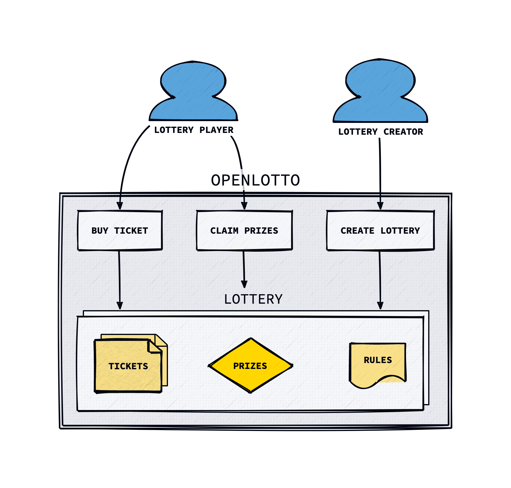

# OpenLotto - An Open-source Blockchain-based Lottery Platform

[](https://opensource.org/licenses/MIT)

## Table of Contents

- [Introduction](#introduction)
- [Features](#features)
- [Architecture](#architecture)
  - [Interface](#interface)
  - [Lottery Operator](#lottery-operator)
  - [Data](#data)
- [Setup](#setup)
- [Usage](#usage)
- [TypeScript Bindings](#typescript-bindings)
- [Donations](#donations)

## Introduction

### What is OpenLotto?

OpenLotto is an open-source blockchain-based lottery platform with focus on transparency, security and fairness.

### How does it work?

OpenLotto leverages smart contracts to create a tamper-proof and auditable lottery system, where lottery creators and players can interact in a trustless environment. This ensures that the lottery rules are adhered to by all parties involved, from the creation of the lottery, the purchase of tickets, the drawing of the winners, to the distribution of the prizes.



## Features

- **Decentralization**: OpenLotto operates on a decentralized blockchain network, harnessing the power of distributed consensus to eliminate the need for trust in a central authority.

- **Transparency**: All lottery transactions and outcomes are recorded on the blockchain, creating an immutable and publicly accessible ledger. This transparency enables players to audit and verify the entire lottery process.

- **Security**: The utilization of blockchain technology ensures the immutability of lottery data, making it tamper-resistant and highly secure. Each transaction and decision is cryptographically linked, creating an unbreakable chain of trust.

- **Fairness**: OpenLotto sticks to fairness by leveraging transparency to empower lottery players to independently verify the selection process for winners in an equitable gaming environment.

- **Extensible**: OpenLotto is extensible to enable the creation of various types of lotteries with a wide spectrum of gameplay mechanics.

## Architecture

The architecture of OpenLotto revolves around three fundamental concepts, each encapsulated within a distinct smart contract. This design promotes both the flexibility and extensibility of the platform.

### Interface

The **Interface** serves as the primary gateway for interactions with OpenLotto. It offers administrative functions for lottery creation, ticket purchasing, and prize claiming. Additionally, it integrates the ERC721 standard, allowing tickets to be treated as NFTs (Non-Fungible Tokens).

- `CreateLottery`: Creates a new lottery with specified attributes. Only users with the `LOTTERY_MANAGER_ROLE` can call this function. The lottery's operator must have granted `OPERATOR_CONTROLER_ROLE` to the `OpenLotto` contract beforehand; otherwise the call reverts with `OperatorRoleMissing()`.
- `ReadLottery`: Retrieves details of a specific lottery.
- `BuyTicket`: Enables users to purchase a lottery ticket by providing the necessary ticket details and sending the appropriate amount of Ether.
- `ReadTicket`: Retrieves details of a specific ticket.
- `TicketPrizes`: Gets the list of prizes for a given ticket in a specific round.
- `ClaimTicket`: Called by the lottery's operator (and only by the operator) to mark a ticket as eligible to withdraw the prize for a given round, after the operator has resolved that round.
- `WithdrawTicket`: Allows ticket holders to withdraw their winnings for a given ticket in a specific round. Requires the ticket to have been claimed first.

### Lottery Operator

The **Lottery Operator** houses the logic tailored to different types of lottery games. By segregating the game-specific logic into separate operator contracts, OpenLotto can support a wide variety of lottery types without cluttering the main interface.

Operators must implement `LotteryOperatorInterface` (defined in `src/models/LotteryModel.sol`). To build a new operator, subclass [`src/operators/BaseLotteryOperator.sol`](src/operators/BaseLotteryOperator.sol) and override the hooks for ticket validation, prize calculation, and winner determination. The `OpenLotto` contract must be granted `OPERATOR_CONTROLER_ROLE` on each operator it drives.

### Data

The **Data** layer stores all data related to lotteries, including the configuration and rules associated with the Lottery Operator, as well as the details of tickets purchased by participants.

#### Lottery Data Model

The Lottery data model serves as the backbone of individual lottery instances within the platform, providing a foundation for creating and managing diverse types of lotteries.

Attributes of the Lottery data model include:

- `Name`: Human-readable identifier for the lottery.
- `InitBlock`: Block number at which the lottery rounds are initialized or started.
- `Rounds`: Number of rounds or iterations for the lottery (how many times the lottery will be played).
- `RoundBlocks`: Number of blocks between each round.
- `BetPrice`: Cost of a single bet for the lottery.
- `JackpotMin`: Minimum size of the lottery jackpot.
- `DistributionPoolTo`: Destination for the distribution pool entries. `address(0)` sends money to the reserve; remaining value goes to the jackpot.
- `DistributionPoolShare`: Share (%) for the distribution pool entries.
- `PrizePoolShare`: Share (%) for the prize pool entries.
- `PrizePoolAttributes`: Attributes for the operator to process the prize pool entries.
- `Operator`: Contract that 'operates' this lottery.
- `Attributes`: Attributes for the operator.

#### Ticket Data Model

The Ticket data model represents an individual lottery ticket purchased by a participant, functioning as a vital element for tracking and validating user participation in lotteries. Tickets play a crucial role in verifying and awarding prizes to deserving winners.

Attributes of the Ticket data model include:

- `LotteryID`: Reference identifier of the lottery associated with the ticket.
- `LotteryRoundInit`: Starting round of the lottery for which the ticket is playing.
- `LotteryRoundFini`: Ending round of the lottery for which the ticket is playing.
- `NumBets`: Number of bets the ticket is processing (typically 1). The ticket cost and prize are affected by this value.

## Setup

### Dependencies

- [Foundry](https://book.getfoundry.sh/)

```
$ curl -L https://foundry.paradigm.xyz | bash
$ source ~/.bashrc
$ foundryup
```

### Clone

```
$ git clone --recurse-submodules https://github.com/apuigsech/openlotto-contracts.git
```

If you already cloned without submodules, run `git submodule update --init --recursive`.

### Install Libraries

```
$ forge install
```

### Build

```
$ forge build
```

### Test

```
$ forge test
```

### Deploy (Local)

```
$ anvil
$ LOTTERY_MANAGER_ADDR=0x... forge script script/DeployOpenLotto.s.sol --tc DeployOpenLotto --rpc-url http://127.0.0.1:8545 --broadcast
```

To deploy and seed the local node with sample lotteries:

```
$ LOTTERY_MANAGER_PRIV_KEY=0x... NUM_LOTTERIES=5 \
  forge script script/DeployOpenLottoWithSampleData.s.sol --rpc-url http://127.0.0.1:8545 --broadcast
```

## Usage

The following examples use [ethers.js](https://docs.ethers.org/) and the published TypeScript bindings. Contract addresses and ABIs are produced by the deploy script.

### Create a lottery (manager only)

```ts
import { ethers } from "ethers";
import { OpenLotto__factory } from "@apuigsech/openlotto-bindings";

const openlotto = OpenLotto__factory.connect(OPENLOTTO_ADDR, manager);

const lottery = {
  Name: "My Lottery",
  InitBlock: (await provider.getBlockNumber()) + 100,
  Rounds: 10,
  RoundBlocks: 100,
  BetPrice: ethers.parseEther("0.1"),
  JackpotMin: 0n,
  DistributionPoolTo: [ethers.ZeroAddress, ethers.ZeroAddress, ethers.ZeroAddress, ethers.ZeroAddress, ethers.ZeroAddress],
  DistributionPoolShare: [0n, 0n, 0n, 0n, 0n],
  PrizePoolShare: [ethers.parseUnits("1", 18), 0n, 0n, 0n, 0n, 0n, 0n, 0n, 0n, 0n],
  PrizePoolAttributes: new Array(10).fill("0x" + "00".repeat(32)),
  Operator: OPERATOR_ADDR,
  Attributes: "0x",
};

await openlotto.CreateLottery(lottery);
```

### Buy a ticket

```ts
const ticket = {
  LotteryID: 1,
  LotteryRoundInit: 1,
  LotteryRoundFini: 1,
  NumBets: 1,
};

await openlotto.BuyTicket(ticket, { value: ethers.parseEther("0.1") });
```

> **Donations to the jackpot.** `BuyTicket` does not refund excess `msg.value`. Any amount above the required ticket cost is routed through the same split as the cost itself: the `DistributionPoolShare` destinations receive their percentages of the full `msg.value`, and the remainder is added to the per-round jackpots (with any dust from integer division going to the last round the ticket covers). Pay exactly `ticketCost` unless you intend the surplus as a donation to the pools/jackpot.

### Claim and withdraw

Tickets begin in an unclaimed state. The lottery's operator must call `ClaimTicket(ticket_id, round)` on `OpenLotto` to mark a ticket as eligible for withdrawal after resolving the round — only the address stored as the lottery's `Operator` can do this. Once claimed, the ticket owner calls `WithdrawTicket(ticket_id, round)` to receive the prize. If the prize transfer fails, the whole call reverts and the ticket remains claimed so the owner can retry.

### Read state and withdraw prizes

```ts
const lottery = await openlotto.ReadLottery(1);
const prizes = await openlotto.TicketPrizes(ticketId, round);
await openlotto.WithdrawTicket(ticketId, round);
```

## TypeScript Bindings

Typed ethers.js contract bindings live in [`src/bindings/`](src/bindings) and are published to GitHub Packages as [`@apuigsech/openlotto-bindings`](https://github.com/apuigsech/openlotto-contracts/packages).

To consume them, authenticate to GitHub Packages and install:

```
$ npm install @apuigsech/openlotto-bindings
```

The bindings package is regenerated by CI from the merged ABIs of `OpenLotto`, the databases, and the base operator. Run the bindings test suite locally with:

```
$ forge build --extra-output-files abi
$ npm test
```

## Donations

If you find OpenLotto valuable and would like to support its development and maintenance, you can contribute through donations:

- **Bitcoin (BTC)**: _TBD_
- **Ethereum (ETH)**: _TBD_

Thank you ❤️ for considering a donation. Your contributions help continue to improve and expand the capabilities of the platform.
